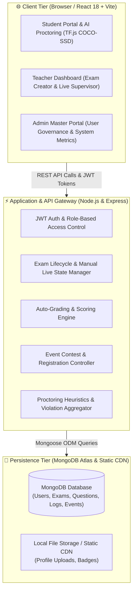

# 🛡️ SafeExam.Ai — Next-Gen AI-Powered Online Examination & Intelligent Proctoring System

[](https://react.dev/)
[](https://vitejs.dev/)
[](https://tailwindcss.com/)
[](https://nodejs.org/)
[](https://expressjs.com/)
[](https://www.mongodb.com/)
[](https://www.tensorflow.org/js)

---

## 📌 Executive Summary

**SafeExam.Ai** is a state-of-the-art, secure, and distributed online examination platform engineered to uphold absolute academic integrity during remote, unproctored, and hybrid assessments. Leveraging edge-based **TensorFlow.js computer vision models**, real-time biometric analysis, and event-driven heuristic monitoring, SafeExam.Ai provides uncompromising cheat prevention without compromising student privacy or transmitting invasive video feeds to third-party cloud servers.

The platform provides dedicated, granularly controlled ecosystems for **Students**, **Teachers**, and **System Administrators**, complete with automated grading, instant PDF score reporting, community event contests, and intelligent real-time proctoring supervision.

---

## 🏛️ 3-Tier Distributed Architecture

The system utilizes an enterprise 3-tier distributed architecture ensuring strict separation of concerns, high throughput, and zero-latency client-side AI inference:



---

## 👁️ AI Proctoring Engine & Violation Penalty Matrix

SafeExam.Ai executes deep learning inference directly on the client's device using **TensorFlow.js WebAssembly/WebGL hardware acceleration**. The proctoring engine monitors video frames, audio levels, tab visibility, and window focus simultaneously.

Every violation incurs weighted **Demerit Points**. If an examinee accumulates penalty points surpassing the critical threshold, the session triggers an automatic freeze and instant examination auto-submission.

### ⚖️ Violation & Demerit Points Matrix

| Action / Violation | Detection Method | Demerit Points | System Action |
|:---|:---|:---:|:---|
| 📋 **Copy / Paste / Cut / Select All** | Keyboard DOM Trapping (`Ctrl+C`, `Ctrl+V`, `Ctrl+X`, `Ctrl+A`) | **+1 pt** | Action blocked & logged |
| 🔄 **Tab Switching / Window Blur / Minimize** | HTML5 Visibility API & Window Blur Event | **+2 pts** | Logged in live proctoring feed |
| 🎙️ **Student Speaking / Talking** | Web Audio API Real-time Voice Analyzer | **+1 pt** | Logged with voice timestamp |
| 📦 **Object Detection (Phone, Book, People)** | COCO-SSD Computer Vision | **0 pts** | No demerits added (Uses 5s Auto-Submit rule) |

### 🚨 Comprehensive Auto-Submit Triggers

| Trigger Condition | Threshold Time | Action & Behavior |
|:---|:---:|:---|
| 📱 **Cell Phone Detected** | **5 Seconds** | **Instant Auto-Submit** (No warning or countdown popup) |
| 👥 **Multiple Persons in Camera** | **5 Seconds** | **Instant Auto-Submit** (No warning or countdown popup) |
| 📖 **Book / Notebook in View** | **5 Seconds** | **Instant Auto-Submit** (No warning or countdown popup) |
| 👤 **Student Absent / Camera Blur** | **5 Seconds** | **Instant Auto-Submit** (No face visible or camera obscured) |
| ⚠️ **Demerit Points Threshold** | **5+ Points** | **Immediate Auto-Submit** upon reaching 5 points |
| 🌐 **Network Disconnection** | **30 Seconds** | **Auto-Submit** if offline for more than 30s |
| ⏳ **Exam Duration Expired** | **00:00 Countdown** | **Auto-Submit** when time limit is reached |
| 🔄 **Page Reload Interception** | **F5 / Ctrl+R** | Confirmation Modal: If confirmed, **Auto-Submits**; if cancelled, exam continues |

---

## 🌟 Core System Portals & Features

### 1. 🎓 Student Portal
- **Active Dashboard & Search:** Real-time search by exam name, course code, or university.
- **Dynamic Score Presentation:** Formatted as two-digit padded fractional marks (e.g., `03/10`, `08/20`).
- **Interactive Answersheet:** Color-coded review highlighting correct answers (`Emerald Green`) vs. incorrect student answers (`Rose Red`).
- **Dual-Tab Community Events:**
  - *All Events Tab:* Explore upcoming competitions and register instantly.
  - *Registered Events Tab:* View registered contests, copy secret exam passcodes with one-click, and launch live tests via **"Go for Exam"**.
- **Automated Pre-Flight Webcam Check:** Progressive device release and permission recovery preventing blank screen errors.

### 2. 👨‍🏫 Teacher Portal
- **100% Manual Exam Live Control:** Teacher explicitly controls exam lifecycle via **"Make Live"** and **"Stop Exam"** buttons (system auto-start interval eliminated).
- **Auto-Fill Event Password:** Event exams automatically populate the secret passcode into the live authorization modal.
- **Rich Question Builder:** Multiple choice question creator with support for bulk question import and category tags.
- **Multi-Select & Bulk Operations:** Bulk delete questions and exams with single-click batch confirmations.
- **Real-Time Proctoring Monitor:** View live demerit points, violation counts, and suspicious behavior logs.

### 3. 🛡️ Admin Master Portal
- **Enterprise Governance:** Full oversight of Faculty, Students, and System Administrators.
- **Exams Multi-Select Bulk Delete:**
  - Header *Select All* checkbox and individual row selectors.
  - Cascading backend deletion (`Exam`, `ExamQuestion`, `StudentExam`, `StudentAnswer`, `ProctoringLog`).
  - **Live Exam Safety Lock:** Prevents accidental deletion of exams currently in session.
- **Events Manager Bulk Delete:** Manage university webinars, competitions, and participant rosters with batch deletion.
- **Proctoring Audit Logs:** Centralized timeline of all flagged violations with student identities and timestamps.

### 4. 🎨 Modern Dialog System (`AlertContext.jsx`)
- Complete replacement of default browser dialogs (`safeexamnet.netlify.app says...`).
- Backdrop blur, scale animations, keyboard `ESC` dismissal, and semantic color-coding.
- Global window interception ensuring zero ugly browser alerts across all existing and future workflows.

---

## 📂 Project Directory Structure

```plaintext
safeExam.Ai/
├── .gitignore
├── ai.txt                          # Comprehensive master project guide & changelog
├── dummy_code.txt                  # System audit and dead code removal tracker
├── README.md                       # Master documentation & architecture guide
├── run_servers.bat                 # One-click Windows batch server launcher
├── run.bat                         # Quick shortcut launcher
├── stop_servers.bat                # One-click server termination utility
│
├── backend/                        # Node.js & Express REST API Server
│   ├── package.json
│   ├── src/
│   │   ├── index.js                # Server entry point & Express bootstrap
│   │   ├── config/
│   │   │   └── db.js               # MongoDB Mongoose connection
│   │   ├── controllers/
│   │   │   ├── adminController.js   # Admin metrics & bulk deletion APIs
│   │   │   ├── authController.js    # JWT authentication & password reset
│   │   │   ├── eventController.js   # Events management & registration
│   │   │   ├── proctorController.js # Proctoring violation logging
│   │   │   ├── studentController.js # Student exams, scoring & answer sheets
│   │   │   └── teacherController.js # Exam authoring & manual live toggle
│   │   ├── middleware/
│   │   │   └── authMiddleware.js    # JWT verification & role gatekeeper
│   │   ├── models/                  # Mongoose Schema Definitions
│   │   │   ├── Admin.js
│   │   │   ├── Event.js
│   │   │   ├── EventRegistration.js
│   │   │   ├── Exam.js
│   │   │   ├── ExamQuestion.js
│   │   │   ├── ProctoringLog.js
│   │   │   ├── Student.js
│   │   │   ├── StudentAnswer.js
│   │   │   ├── StudentExam.js
│   │   │   └── Teacher.js
│   │   └── routes/                  # Express Router Modules
│   │       ├── adminRoutes.js
│   │       ├── authRoutes.js
│   │       ├── eventRoutes.js
│   │       ├── proctorRoutes.js
│   │       ├── studentRoutes.js
│   │       └── teacherRoutes.js
│   └── uploads/                     # Static file upload directory
│
└── frontend/                       # Vite + React 18 Single Page Application
    ├── package.json
    ├── vite.config.js
    ├── tailwind.config.js
    └── src/
        ├── App.jsx                 # Route definitions & AlertProvider wrapper
        ├── main.jsx                # Application root mounting
        ├── api/
        │   └── axiosConfig.js      # Axios instance with interceptors
        ├── context/
        │   └── AlertContext.jsx    # Centralized custom modal dialog system
        ├── components/
        │   ├── Modal.jsx           # Reusable UI modal
        │   └── TopMenu.jsx         # Navigation header
        └── pages/
            ├── AdminDashboard.jsx  # Admin portal & bulk operations
            ├── EventsManager.jsx   # Event management & attendee logs
            ├── ExamInterface.jsx   # Proctoring interface with TF.js COCO-SSD
            ├── Login.jsx           # Unified multi-role authentication
            ├── Register.jsx        # Student self-registration with OTP
            ├── StudentDashboard.jsx# Student exam portal & score analytics
            ├── StudentEvents.jsx   # Dual-tab community events & registration
            ├── SubjectInsights.jsx # Analytical subject metrics
            ├── TeacherDashboard.jsx# Exam creation & live proctoring dashboard
            └── TeacherProctoring.jsx# Dedicated live exam proctoring grid
```

---

## 🚀 Setup & Installation Guide

### Prerequisites
- **Node.js**: v18.0.0 or higher
- **npm**: v9.0.0 or higher
- **MongoDB**: Local MongoDB instance or MongoDB Atlas URI

### 1. Clone the Repository
```bash
git clone https://github.com/MehediHasan9339/safeExam.Ai.git
cd safeExam.Ai
```

### 2. Environment Configuration
Create a `.env` file inside the `backend/` directory:
```env
PORT=5000
MONGO_URI=mongodb+srv://<username>:<password>@cluster.mongodb.net/safeexam?retryWrites=true&w=majority
JWT_SECRET=your_super_secret_jwt_key_here
```

### 3. Quick Start (Windows — 1-Click Launch)
Simply double-click **`run_servers.bat`** (or **`run.bat`**) in the root directory.

It will automatically:
- Start the Backend Server on `http://localhost:5000`
- Start the Frontend Vite Server on `http://localhost:5173`
- Open your default browser directly to the application

To stop all servers at once, double-click **`stop_servers.bat`**.

### 4. Manual Start (Cross-Platform)

#### Backend:
```bash
cd backend
npm install
npm start
```

#### Frontend:
```bash
cd frontend
npm install
npm run dev
```

---

## 👨‍💻 Engineering & Development Credits

Developed with ❤️ as the Final Capstone Project for the Department of Computer Science & Engineering, **Primeasia University**:

- **MD Mehedi Hasan** — ID: `232004048`
- **MST Onamika Jannat Ara** — ID: `232005048`

---

## 📄 License
This project is proprietary and developed for academic and institutional evaluation. All rights reserved.

