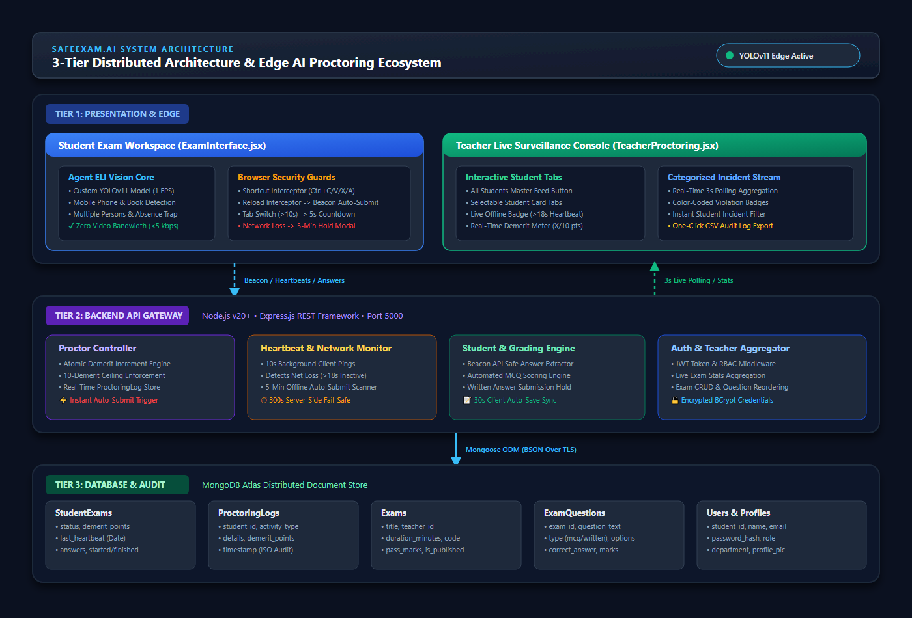
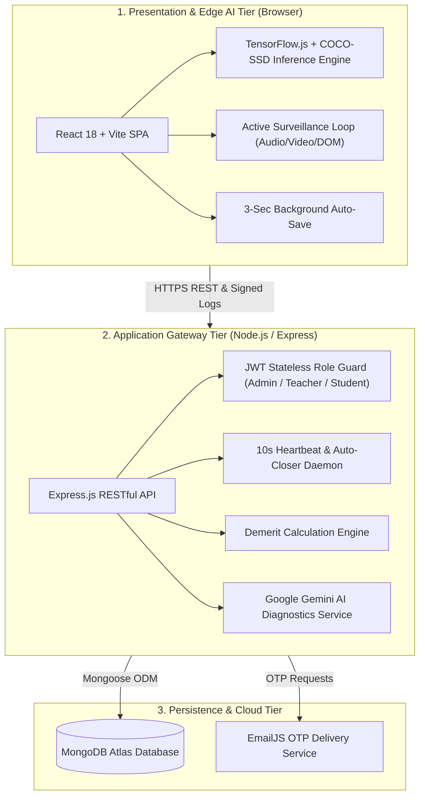

# 🛡️ SafeExam.AI — AI-Powered Online Examination & Intelligent Proctoring Platform

<div align="center">



[](https://react.dev/)
[](https://vitejs.dev/)
[](https://tailwindcss.com/)
[](https://nodejs.org/)
[](https://expressjs.com/)
[](https://www.mongodb.com/)
[](https://www.tensorflow.org/js)
[](https://deepmind.google/technologies/gemini/)

**A Next-Generation, Full-Stack, AI-Driven Online Examination Platform with Zero-Server-Lag Edge Proctoring, Automated Evaluation, and Real-Time Malpractice Prevention.**

[Live Repository](https://github.com/mehedi-11/safeExam.Ai.git) • [System Architecture](Diagram/README.md) • [Key Features](#-core-capabilities--innovations) • [Quick Start](#-quick-start--installation) • [Portals](#-portal-architecture)

</div>

---

## 📖 Executive Summary

**SafeExam.AI** is a comprehensive academic examination ecosystem engineered to eradicate academic malpractice in remote digital tests while completely eliminating server-side video streaming bottlenecks. 

Traditional remote proctoring systems transmit hundreds of heavy video feeds to central servers, creating severe bandwidth congestion and latency. SafeExam.AI redefines this model by deploying **Edge AI (Computer Vision via TensorFlow.js & COCO-SSD)** directly inside the examinee's web browser. The client device autonomously analyzes video frames locally in real time, detecting unauthorized objects (smartphones, notes, extra screens) or multiple faces, sending only lightweight signed incident metadata to the server.

Combined with an unyielding **Browser Lockdown Protocol**, **10-Point Demerit Penalty System**, **5-Minute Network Loss Fail-Safe**, and **Agent-ELI / Google Gemini AI Personalized Diagnostics**, SafeExam.AI delivers absolute integrity, fault tolerance, and educational insight.

---

## 🚀 Core Capabilities & Innovations

### 1. 👁️ Edge Computer Vision & In-Browser Proctoring (Zero Server Lag)
- **Zero Video Bandwidth Cost**: All machine learning inference executes on the student's hardware via `@tensorflow/tfjs` and `@tensorflow-models/coco-ssd`.
- **Real-Time Object Detection**:
  - 📱 **Cell Phone Detection**: Immediate detection of handheld mobile devices.
  - 👥 **Multiple Faces / Persons**: Flags when an auxiliary person enters the camera frame.
  - 📚 **Books & Notes**: Detects reading materials in the test workspace.
  - 🖥️ **External Monitors / Screens**: Flags secondary monitors.
  - 👤 **Absence From Camera**: Detects when the candidate leaves their seat.

### 2. ⚖️ 10-Point Demerit Penalty & Instant Auto-Submit Matrix
- Violations accrue demerit points dynamically based on severity.
- Reaching or exceeding **10 Demerit Points** triggers an automatic, unbypassable examination lockdown and final auto-submission.
- Real-time warning modals alert students before irreversible penalties occur.

### 3. 🌐 Dual-Layer Network Disconnection Resilience (5-Minute Hold)
- **10-Second Ping Heartbeat**: Continuous bidirectional verification between client and backend.
- **Immediate Pause on Drop**: If the student's connection drops, the test interface freezes with an unclosable connection recovery dialog, protecting test time.
- **Fail-Safe Auto-Submit**: If disconnected for $> 5$ minutes, the server daemon automatically closes and finalizes the test attempt based on cached state.

### 4. 🔒 Complete Browser Lockdown & Anti-Cheat Guards
- **Fullscreen Enforcement**: Candidates must remain in fullscreen mode throughout the sitting; exiting triggers instant warnings and demerits.
- **Key Binding Trapping**: Intercepts and suppresses developer shortcuts (`F12`, `Ctrl+Shift+I`, `Ctrl+U`), tab-switching (`Alt+Tab`, `Cmd+Tab`), reload (`F5`, `Ctrl+R`), and clipboard commands (`Ctrl+C`, `Ctrl+V`).
- **Context Menu & Text Selection Neutralization**: Right-click menus and text highlighting are disabled.
- **Automated Periodic Auto-Save**: Responses auto-save every 3 seconds to guarantee zero loss of answers.

### 5. ⚡ Automated MCQ Evaluation & Visual Color-Coded Answersheet
- **Instant MCQ Marking**: Multiple-choice assessments are graded in milliseconds upon submission.
- **Visual Answersheet Review**:
  - Correct answers chosen by the student are highlighted in vibrant **Emerald Green** (`✓ Correct`).
  - Incorrect choices are clearly labeled in **Rose Red** with strike-through (`✗ Student's Answer`), displaying the correct option side-by-side.
  - Manual grading interface for written/descriptive answers with instant total score re-computation.

### 6. 🤖 Subject Insights Powered by Agent-ELI & Google Gemini AI
- Analyzes historical exam results and generates custom strengths and weakness diagnostics.
- Outlines an actionable checklist and prioritized study roadmap tailored to individual academic gaps.

### 7. 🗂️ Bulk Data Management & Administrative Controls
- **Select-to-Delete**: Multi-select checkboxes and bulk deletion across Exams, Teachers, Students, Questions, and Events.
- **CSV Bulk Import**: Bulk enroll hundreds of students and faculty members in seconds via PapaParse.
- **PDF Report Generation**: Instant export of student rosters, examination answer sheets, and complete violation logs using `jsPDF` and `jspdf-autotable`.

---

## 🏛️ System Architecture

SafeExam.AI follows a modular **3-Tier Distributed Architecture**:



*For complete vector and high-resolution architecture diagrams, visit the [`/Diagram`](Diagram/README.md) catalog.*

---

## 📊 Violation Penalty Matrix

| Violation Type | Severity | Demerit Penalty | System Consequence |
| :--- | :---: | :---: | :--- |
| **Cell Phone Detected** | Critical | **Instant Hold / +5** | 5s Confirm Modal + Snapshot Logged |
| **Tab Switch / Window Blur** | High | **+2 Demerits** | Audio alarm + 10s countdown countdown |
| **Multiple Persons in Frame** | High | **+2 Demerits** | On-screen warning modal + Incident recorded |
| **Prohibited Keyboard Shortcuts** | Medium | **1st: Warn / 2nd: +1** | Keystroke intercepted and nullified |
| **Browser Reload (F5/Ctrl+R)** | Critical | **Forced Submit** | Session terminated for integrity |
| **Fullscreen Exit** | Medium | **+1 Demerit** | Locked until fullscreen re-established |
| **10 Total Demerit Points** | Fatal | **Lockout** | **Automatic Exam Final Submission** |
| **Network Loss $> 5$ Minutes** | System | **Server Auto-Submit** | Background worker finalizes attempt |

---

## 👥 Portal Architecture

SafeExam.AI features three strictly isolated, role-guarded portals:

### 🛡️ 1. Administration Portal
- **Global Overview**: Real-time KPI statistics (Total Teachers, Students, Live Exams, Total Registrations).
- **Teacher Governance**: Review pending registrations, approve/reject teacher applications, suspend accounts, and bulk delete faculty.
- **Student Governance**: View complete academic histories, exam attempts, scores, and status flags.
- **All Exams Oversight**: Live oversight of every test across faculties; instant cancellation or bulk deletion of invalid exams.
- **Proctoring Log Downloads**: Inspect and download comprehensive proctoring violation logs in PDF.
- **CSV Bulk Import**: Batch enroll students and instructors.

### 👨‍🏫 2. Teacher Portal
- **Exam Builder**: Set course codes, custom passwords, duration, start/end dates, and allowed attempt limits (1, 2, 3+).
- **Question Bank Designer**: Formulate MCQs (with automated grading keys) and Descriptive/Written questions; reorder questions via drag-and-drop.
- **Live Proctoring Room**: Real-time counter of registered, active, and submitted examinees; second-by-second live incident log feed.
- **Answersheet Grading Hub**: Color-coded visual evaluation of individual student papers; assign manual marks for descriptive answers.
- **Publish/Unpublish**: Control when scores and solutions become visible to students.
- **Events & Contests**: Create and host university events, contests, and hackathons.

### 🎓 3. Student Portal
- **Exam Lounge**: Filter active and upcoming test sittings; one-click entry using security credentials.
- **Secure Locked Exam Workspace**: Pre-flight camera and microphone diagnostics; clean fullscreen test layout with countdown timer.
- **My Results**: Searchable record of past performances, percentages, and teacher remarks.
- **Subject Insights (Agent-ELI)**: Visual analytics breakdown (radar/bar charts) with AI-curated improvement recommendations.
- **Registered Events**: View enrolled hackathons and contests, retrieve secret test keys, and launch event tests.

---

## 🛠️ Technology Stack

| Domain | Technologies |
| :--- | :--- |
| **Frontend Framework** | React 18.3, Vite 5.4 |
| **Styling & Icons** | Tailwind CSS 3.4, Lucide React |
| **Client-Side AI & CV** | TensorFlow.js (`@tensorflow/tfjs` 4.22), COCO-SSD (`@tensorflow-models/coco-ssd` 2.2) |
| **Data Visualization** | Recharts 3.10 |
| **Document Processing** | jsPDF, jspdf-autotable, PapaParse 5.5, React Quill 2.0 |
| **Backend Runtime** | Node.js (v18+ recommended), Express.js 4.19 |
| **Database & ODM** | MongoDB Atlas, Mongoose 8.x |
| **Security & Auth** | JSON Web Tokens (JWT), Bcrypt.js, CORS |
| **External AI & Cloud** | Google Gemini API, EmailJS REST API |

---

## 📂 Project Structure

```
safeExam.Ai/
├── Agent-ELI/                # Standalone AI weights & YOLO model assets
│   ├── calculator.pt
│   ├── COCOv11.onnx
│   ├── COCOv11.pt
│   └── headphone.pt
├── backend/                  # Node.js & Express RESTful API Server
│   ├── src/
│   │   ├── config/           # MongoDB connection & system configurations
│   │   ├── controllers/      # admin, teacher, student, event, exam logic
│   │   ├── middleware/       # JWT auth, role validation (authMiddleware.js)
│   │   ├── models/           # Mongoose schemas (Exam, Student, ProctoringLog, etc.)
│   │   ├── routes/           # Express endpoint definitions
│   │   ├── utils/            # EmailJS sender, helpers
│   │   └── index.js          # Express entry point & cron task worker
│   ├── package.json
│   └── .env
├── Diagram/                  # High-resolution architectural models & diagrams
│   ├── 01_System_Architecture_Diagram.png (.svg, .mmd)
│   ├── 02_Use_Case_Diagram.png (.svg, .mmd)
│   ├── 03_System_Workflow_Activity_Diagram.png (.svg, .mmd)
│   ├── 04_Database_ER_Diagram.png (.svg, .mmd)
│   ├── 05_Proctoring_Violation_Decision_Flowchart.png (.svg, .mmd)
│   ├── 06_Network_Hold_and_Failure_Sequence_Diagram.png (.svg, .mmd)
│   ├── index.html            # Interactive diagram viewer
│   └── README.md
├── frontend/                 # React 18 SPA (Vite + Tailwind CSS)
│   ├── src/
│   │   ├── api/              # Axios configuration & interceptors
│   │   ├── assets/           # Logos, icons, and illustrations
│   │   ├── components/       # Modal, Navbar, TopMenu, WelcomeHeader, etc.
│   │   ├── pages/            # AdminDashboard, TeacherDashboard, StudentDashboard,
│   │   │                     # ExamInterface, EventsManager, StudentEvents, etc.
│   │   ├── App.jsx           # Main routing configuration
│   │   └── main.jsx          # React DOM entry
│   ├── package.json
│   ├── tailwind.config.js
│   ├── vite.config.js
│   └── .env
├── ai.txt                    # Project master documentation & revision log
└── README.md                 # Project README
```

---

## ⚡ Quick Start & Installation

### Prerequisites
- [Node.js](https://nodejs.org/) (v18.x or higher)
- [npm](https://www.npmjs.com/) or [yarn](https://yarnpkg.com/)
- [MongoDB Atlas](https://www.mongodb.com/) cluster or local MongoDB instance

---

### Step 1: Clone the Repository
```bash
git clone https://github.com/mehedi-11/safeExam.Ai.git
cd safeExam.Ai
```

---

### Step 2: Backend Setup
1. Navigate into the backend directory and install dependencies:
```bash
cd backend
npm install
```

2. Create a `.env` file in the `backend/` folder:
```env
PORT=5000
MONGO_URI=mongodb+srv://<username>:<password>@cluster0.mongodb.net/safeexam?retryWrites=true&w=majority
JWT_SECRET=your_super_secret_jwt_key_here
GEMINI_API_KEY=your_google_gemini_api_key_here
```

3. Start the backend server:
```bash
npm start
# Server runs on http://localhost:5000
```

---

### Step 3: Frontend Setup
1. Open a new terminal, navigate into the frontend directory, and install dependencies:
```bash
cd frontend
npm install
```

2. Create a `.env` file in the `frontend/` folder:
```env
VITE_API_BASE_URL=http://localhost:5000/api
```

3. Launch the Vite development server:
```bash
npm run dev
# Application accessible at http://localhost:5173
```

---

### Step 4: Build for Production
To generate minified, production-ready frontend bundles:
```bash
cd frontend
npm run build
```

---

## 🔒 Security & Privacy Commitments

- **Zero Face Storage**: SafeExam.AI never uploads or persists raw webcam photos or continuous video feeds to cloud storage. Only numeric incident event records are captured.
- **Stateless Authorization**: Passwords are encrypted using one-way cryptographic hashing (`bcryptjs` with salt factor 10). Session tokens expire automatically.
- **Input Sanitization**: Database inputs and queries are strictly validated against injection via Mongoose ODM schemas.

---

## 👥 Authors & Academic Credits

Developed as a Final Year Capstone Project by:

- **MD Mehedi Hasan** (Student ID: `232004048`) — [GitHub Profile](https://github.com/mehedi-11)
- **MST Onamika Jannat Ara** (Student ID: `232005048`)

---

## 📜 License & Citation

This project is licensed under the **MIT License**. Feel free to use, modify, and distribute for academic and development purposes.

```
SafeExam.AI: AI-Powered Online Examination & Intelligent Proctoring System.
Copyright (c) 2026 MD Mehedi Hasan & MST Onamika Jannat Ara.
```

<div align="center">
  <sub>Built with ❤️ for academic integrity and fair examination.</sub>
</div>
